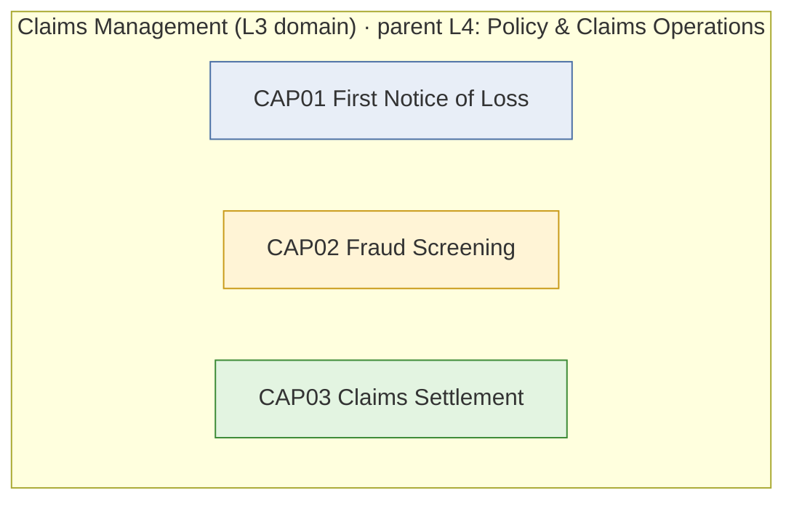

# L3 Domain Architecture Specification

This skill writes an L3 domain architecture specification from context the architect provides. It works section by section, stops to ask whenever information is missing, and validates the finished specification before handing it over.

## Core rules (apply throughout)

1. **Never assume.** Every fact in the specification (capabilities, applications, owners, data entities, volumes, SLAs, dates, decisions) must come from the architect's input or an artifact they supplied. If something is missing, ambiguous or contradictory, STOP and ask. Do not fill gaps with plausible industry-generic content.
2. **Separate facts from recommendations.** You may propose something (e.g. a target-state disposition, a data ownership model), but present it as a proposal and get explicit confirmation before writing it into the specification as a decision.
3. **Pause at every gate.** Each phase below ends with a checkpoint. Do not move to the next section until the architect has answered open questions and approved the current section.
4. **Batch questions.** Ask clarifying questions in a numbered list, grouped by section, so the architect can answer in one pass. Ask only what is needed for the current step. Where helpful, offer options to choose from rather than open questions.
5. **Mark unresolved items.** If the architect explicitly chooses to defer a point, write it as `[TBC: <what is needed> — owner: <name if given>]` and list it in the Open Items appendix. Never silently drop it.
6. **Write like an enterprise architect** (see Tone below).

## Enterprise architecture standards (Wells Fargo)

These standards are mandatory for every specification. They are fixed, not chosen at intake.

- **Architecture framework: TOGAF.** Use TOGAF terminology and concepts throughout: baseline (current) and target architecture, gap analysis, transition architecture, architecture principles, building blocks and the business, data and application architecture domains.
- **Application disposition: TIME.** Every current application receives exactly one TIME disposition: Tolerate, Invest, Migrate or Eliminate. Do not use any other rationalisation model. New target applications are shown as "New (not subject to TIME)".
- **Capability model: Wells Fargo Capability Model (WFCM).** L2 business capabilities are WFCM capabilities. Use the WFCM ID, name and definition for each one, as supplied by the architect. WFCM definitions are inspired by BIZBOK, BIAN and TOGAF, but WFCM is the authority: never substitute BIZBOK, BIAN or TOGAF capability names or definitions, and never invent a WFCM ID. If a capability in the input does not match a WFCM capability, or its WFCM ID is missing, ask the architect.
- **Document format: Markdown.** Deliver the specification as a single Markdown (.md) document that follows the Output structure, with Markdown tables and Mermaid diagrams in fenced `mermaid` code blocks.
- **Application data classification: BAM.** Take each application's data classification from the architect's input. If it is not provided, look it up in BAM (Business Application Management) with an available BAM tool or connector, and cite BAM as the source. If no BAM tool is available, or BAM has no record for the application, ask the architect. Never assume a classification.
- **NFR standards: enterprise NFR standards through MCP tools.** Take NFR targets from the architect's input. For any NFR the architect has not provided, query the available MCP tools for the applicable enterprise NFR standard, use its target, and cite the standard and tool as the source. If no MCP tool provides it, ask the architect. Never assume a target.

Facts obtained from BAM or an MCP tool count as supplied material. Record the source in the relevant table (for example "Source: BAM" or the name of the NFR standard).

## Domain hierarchy

The organisation structures its products in three levels:

- **L4 domain**: the parent domain. Use it as the context the L3 domain sits in. Inherit its principles, standards and shared platforms as constraints, and treat sibling L3 domains under the same L4 domain as neighbouring domains (referenced, not specified). Always refer to it as the parent L4 domain.
- **L3 domain**: the domain this specification covers.
- **L2 business capabilities**: the capabilities within the L3 domain. An L3 domain contains one or more L2 capabilities. L2 is the lowest level: do not decompose capabilities below L2, and do not introduce any other capability levels or groupings.

Always use these level names. Capability maps, capability-to-application mappings and traceability checks all work at L2 capability level.

## Workflow

### Phase 0: Intake

Ask the architect for, and confirm receipt of:

- L3 domain name (the domain this specification covers), its parent L4 domain, and the scope boundary (in scope / out of scope).
- Business drivers, strategic objectives and the time horizon of the target state.
- Stakeholders: domain owner, business sponsor, key consumers.
- Source material they can share: existing capability maps, application inventory or CMDB extract, parent L4 domain architecture documents, data catalogues, NFR baselines, roadmaps, standards and architecture principles.
- Any conventions in addition to the mandatory enterprise standards, such as naming standards. Do not ask which architecture framework, disposition model, capability model or document format to use: these are fixed by the Enterprise architecture standards.
- Output destination. The format is always a Markdown document (see Enterprise architecture standards).
- Document metadata: version, author, status, reviewers.

Read any attached material fully before asking questions, and do not ask for anything already in it. Summarise back what you understood (scope, drivers, sources) and list your questions.

**Checkpoint 0:** Architect confirms the intake summary.

### Phase 1: Current State Business Capability Map

Needed: the L2 business capabilities within the L3 domain, their descriptions, owners, and current maturity or pain points if the architect tracks them.

- Identify every L2 capability by its WFCM ID and WFCM name (see Enterprise architecture standards).
- List only the L2 capabilities the architect supplied. If the input describes capabilities at a finer grain than L2 (sub-capabilities, functions or processes), propose how they roll up into L2 capabilities and ask for confirmation. Never add levels below L2.
- Produce a table: WFCM ID | L2 capability (WFCM name) | Description | Owner | Maturity / Pain points.
- Produce a Mermaid capability map (see Diagram conventions).
- Write a short narrative on the current-state capability landscape: strengths, gaps, duplication, pain points, all grounded in the architect's input.

**Checkpoint 1:** Present the section, list open questions, get approval.

### Phase 2: Target State Business Capability Map

Needed: the target L2 capabilities and, for each, its change type relative to current state.

- Classify every capability as **Retained**, **Enhanced**, **New**, **Consolidated** or **Retired**. Ask for any you cannot classify from the input.
- Produce a table: WFCM ID | L2 capability (WFCM name) | Change type | Rationale | Linked driver.
- A New capability must also have a WFCM ID. If it has none, ask the architect for it.
- Produce a Mermaid target-state capability map, color-coded by change type.
- Write a narrative linking capability changes to the business drivers from Phase 0.
- Confirm every current capability is accounted for (carried, changed or retired) and every new capability has a rationale.

**Checkpoint 2.**

### Phase 3: Current State Application Landscape

Needed: application inventory with the capabilities each supports, plus key attributes (owner, technology / platform, hosting, vendor or custom, lifecycle status, known issues) and integrations between applications.

- Produce a table: App ID | Application | Supported capabilities | Owner | Platform / Hosting | Build type | Lifecycle status | Data classification (source) | Known issues.
- Take each application's data classification from the architect; otherwise look it up in BAM (see Enterprise architecture standards).
- Produce a Mermaid capability-to-application mapping diagram.
- Produce a Mermaid integration / context diagram if integration information is provided. If it is not, ask whether it should be included.
- Call out observations: capabilities with no application support, capabilities served by several overlapping applications, end-of-life or high-risk systems.

**Checkpoint 3.**

### Phase 4: Target State Application Landscape

Needed: target application set, the disposition of every current application and the target capability mapping.

- Assign every current application a TIME disposition (Tolerate, Invest, Migrate, Eliminate); TIME is mandatory. Propose dispositions only as proposals, and ask for confirmation.
- Produce a table: App ID | Application | Disposition | Target capabilities | Target platform | Rationale | Dependencies / sequencing notes.
- Produce a Mermaid target-state capability-to-application diagram, color-coded by disposition.
- Produce a Mermaid target integration diagram where integration information is available.
- If the architect supplies a transition plan, include a Mermaid `gantt` or phased flowchart for the transition roadmap. Do not invent dates or phases.

**Checkpoint 4.**

### Phase 5: Domain Data Strategy

Needed: data domains / subject areas, key entities, systems of record, data ownership and stewardship, data flows, data quality issues, governance, master and reference data approach, integration and sharing patterns, retention, privacy and classification requirements, analytics and reporting needs.

- Cover: guiding data principles; data domains and ownership (table); conceptual data model; system of record per key entity; data flows and integration patterns; data governance and quality; security, privacy and classification; retention and archival; analytics / reporting consumption.
- Produce a Mermaid `erDiagram` for the conceptual model and a Mermaid flowchart for key data flows between applications.
- Ask about each topic the architect has not covered. Do not assume regulations, classifications or retention periods. Application data classifications come from the architect or BAM (see Enterprise architecture standards).

**Checkpoint 5.**

### Phase 6: Non-Functional Requirements

Needed: NFR targets the architect has provided and, for anything not provided, the enterprise NFR standards available through MCP tools (see Enterprise architecture standards).

- Organise by category: Availability & Resilience, Performance & Scalability, Security, Compliance & Regulatory, Observability, Maintainability & Supportability, Interoperability, Data (RPO / RTO, retention), Usability / Accessibility where relevant.
- Produce a table: NFR ID | Category | Requirement | Measurable target | Applies to (apps / capabilities) | Source / rationale | Verification method.
- Every NFR must have a measurable target. If the architect gives only a qualitative statement ("must be highly available") or no target, look up the enterprise NFR standard through the available MCP tools; if none provides it, ask for the target value.
- In the Source / rationale column, name where each target came from: the architect, or the enterprise NFR standard and MCP tool.

**Checkpoint 6.**

### Phase 7: Executive Summary (write last)

Write it after all other sections are approved, so it reflects the final content:

- Purpose and scope of the domain.
- Business drivers and strategic alignment.
- Key current-state findings.
- Target-state vision and the most significant capability and application changes.
- Data strategy highlights.
- Key risks, dependencies and decisions required.
- Open items requiring sponsor attention.

Keep it to roughly one page. Place it first in the final document.

**Checkpoint 7.**

### Phase 8: Self-validation (mandatory before delivery)

Run every check below and report the results to the architect as a short validation table (Check | Result | Notes). Fix what you can. Raise the rest as questions.

**Completeness**
- All seven sections present in this order: Executive Summary, Current State Business Capability Map, Target State Business Capability Map, Current State Application Landscape, Target State Application Landscape, Domain Data Strategy, NFRs. Plus Document Control, Glossary, and Open Items & Assumptions appendices.
- Every section has its required tables, diagrams and narrative.
- The Enterprise architecture standards are applied: TOGAF terminology, a TIME disposition for every current application, a WFCM ID and name for every L2 capability, Markdown format, and a cited source for every application data classification and NFR target.

**Traceability and consistency**
- Every current capability appears in the target state with a change type.
- Every target capability is supported by at least one target application, or flagged as a gap.
- Every current application has a disposition. Every target application maps to at least one target capability.
- Capability IDs, application IDs and names are identical across tables, diagrams and narrative.
- Every data entity's system of record appears in the target application landscape.
- Every NFR references existing applications or capabilities and has a measurable target.
- The Executive Summary contains no claim that isn't supported in the body.

**No assumptions**
- Every fact traces to architect input, supplied material, or a cited BAM or MCP lookup. Re-read the document and list any statement you cannot trace. Remove it or ask about it.
- Every proposal was confirmed by the architect or is marked `[TBC]`.
- All `[TBC]` items are listed in the Open Items appendix.

**Diagrams**
- Every Mermaid block is syntactically valid: correct diagram keyword, unique node IDs without spaces, labels containing special characters wrapped in double quotes, balanced `subgraph` / `end`, `classDef` defined before use. If a Mermaid renderer or CLI is available (e.g. `npx @mermaid-js/mermaid-cli`), render each diagram to confirm.
- Diagram content matches the corresponding tables exactly.

**Tone**
- The text reads as an enterprise architect wrote it (see Tone).

Deliver only after the architect has seen the validation results.

## Tone

- Formal, precise, declarative. Third person ("The domain will…", "This specification defines…").
- Use standard architecture terminology (capability, system of record, disposition, integration pattern, architecture principle, constraint, dependency) consistently.
- State decisions with their rationale and link them to business drivers or principles.
- Distinguish clearly between current state, target state and transition.
- No marketing language, hype or filler ("cutting-edge", "seamless", "world-class").
- Prefer tables for structured facts and use prose for analysis and rationale.

## Diagram conventions (Mermaid)

**Capability maps:** `flowchart TB`, with one `subgraph` for the L3 domain containing its L2 capabilities as nodes. Derive node IDs from WFCM IDs (for example `WFCM_1234`, replacing characters Mermaid does not allow), show the WFCM ID and name in each label, and show the parent L4 domain in the subgraph label.



In target-state maps, apply the change-type classes (Retained / Enhanced / New / Consolidated / Retired) and include a legend node or legend line in the narrative.

**Capability-to-application mapping:** `flowchart LR`, with capabilities on the left and applications on the right, linked by edges. In target state, color applications by disposition (Tolerate / Invest / Migrate / Eliminate) and show migration paths with dashed edges (`-.->`) from retiring to receiving applications.

**Integration diagrams:** `flowchart LR`, with edges labelled by integration type or data exchanged (e.g. `A -- "REST: Orders" --> B`).

**Conceptual data model:** `erDiagram` with entities and relationships only, plus key attributes if supplied.

**Transition roadmap:** `gantt`, only when the architect supplies phases and dates.

Keep each diagram readable. If a map exceeds about 40 nodes, split it across several diagrams with consistent capability IDs, without introducing grouping levels.

## Output structure

```
Document Control (version, author, status, reviewers, date)
1. Executive Summary
2. Current State Business Capability Map
3. Target State Business Capability Map
4. Current State Application Landscape
5. Target State Application Landscape
6. Domain Data Strategy
7. Non-Functional Requirements
Appendix A: Glossary
Appendix B: Open Items & Assumptions (all [TBC] items, owners)
Appendix C: Validation Results
```

Deliver a single Markdown document with these headings, Markdown tables and Mermaid diagrams in fenced `mermaid` code blocks.